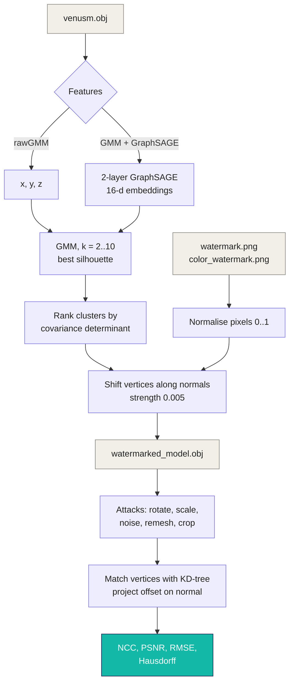

<div align="center">


<a href="#-results"></a>

<br/>

[](https://www.python.org)
[](https://jupyter.org)
[](https://pytorch-geometric.readthedocs.io)
[](https://scikit-learn.org)
[](https://trimesh.org)
<br/>
[](#-status-and-known-limitations)
[](LICENSE)

</div>

---

##  Project Overview

Experiments (August 2025) in **hiding image watermarks inside a 3D mesh**. The Venus statue mesh (`venusm.obj`, 22,573 vertices; a 64x64 colour watermark uses 12,288 of them and the grayscale one 4,096) is split into regions by clustering its vertices; the two most "textured" regions (highest covariance determinant) receive a **colour** and a **grayscale** watermark, each pixel stored as a tiny shift of one vertex along its surface normal. The notebooks then extract the watermarks back, measure quality, and repeat the extraction after common attacks on the mesh.

Two clustering variants are compared, each with 32x32 and 64x64 watermarks:

| Variant | Features clustered |
|---|---|
| **rawGMM** | Vertex x, y, z coordinates |
| **GMM + GraphSAGE** | 16-dimensional vertex embeddings from a 2-layer GraphSAGE network over the mesh edges |

### Key Features

-  **Cluster selection**: GMM with 2 to 10 components, chosen by silhouette score (both variants pick 2).
-  **Dual watermark**: colour (R, G, B flattened) and grayscale images, normalised with one shared scaler.
-  **Normal-direction embedding**: `v' = v + n · w · 0.005`, then the mesh is saved and reloaded to include file-precision loss.
-  **Attack suite**: rotation 45° / 90°, scaling 0.5x / 5x, Gaussian noise 0.01 / 0.15, remeshing (face reduction) 5% / 10%, cropping 10% / 20%.
-  **Metrics**: RMSE, NCC and PSNR per watermark, Hausdorff distance for the mesh.

##  How It Works



Extraction is **non-blind**: it needs the original mesh. Each original watermarked vertex is matched to its nearest vertex in the (possibly attacked) mesh, the offset is projected on the normal and divided by the embedding strength.

##  Results

Without any attack (after save and reload), from the notebook outputs:

| Experiment | Grayscale NCC / PSNR | Colour NCC / PSNR |
|---|---|---|
| rawGMM, 32x32 | 0.935 / 35.6 dB | 0.914 / 39.1 dB |
| rawGMM, 64x64 | 0.943 / 40.1 dB | 0.856 / 35.6 dB |
| GMM + GraphSAGE, 32x32 | 0.942 / 35.4 dB | 0.913 / 38.8 dB |
| GMM + GraphSAGE, 64x64 | 0.910 / 40.2 dB | 0.883 / 35.8 dB |

After **every** attack the NCC falls to about 0 (between -0.09 and 0.19 in the 64x64 GraphSAGE run): the watermark does **not** survive rotation, scaling, noise, remeshing or cropping in this implementation. The roughly 28 dB PSNR after attacks reflects images that are no longer correlated with the original, not a partial recovery.

##  Requirements

- Python 3.10+ and Jupyter
- Packages in [`requirements.txt`](requirements.txt): numpy, scipy, scikit-learn, trimesh, torch, torch_geometric, Pillow, matplotlib, plus `fast-simplification` (remeshing attack) and `shapely` (cropping attack)

##  Quick Start

```bash
git clone https://github.com/mukesh-dev-git/3DMESH_WM.git
cd 3DMESH_WM
python -m venv venv && source venv/bin/activate   # Windows: venv\Scripts\activate
pip install -r requirements.txt
jupyter notebook
```

Open a notebook inside one experiment folder (each folder holds its own `venusm.obj` and watermark images) and run the cells top to bottom. Each attack is a pair of cells: the attack writes a `*_model.obj`, the next cell extracts from it, then the evaluation cell prints the metrics. `helperCodes/cell10.py` and `cell12.py` are copies of the evaluation and extraction cells.

##  Project Structure

```
3DMESH_WM/
├── Venus-both colour+grayscale/
│   ├── Venusm - rawGMM -32x32/          # notebook, venusm.obj, watermarks, attacked meshes
│   ├── Venusm - rawGMM -64x64/
│   ├── Venusm - GMM+GraphSage -32x32/
│   └── Venusm - GMM+GraphSage -64x64/
├── Venus-only grayscale/               # earlier grayscale-only runs (no evaluation cells)
│   ├── Venusm - rawGMM/
│   └── Venusm - GMM+GraphSage/
├── helperCodes/                        # cell10.py (evaluation), cell12.py (extraction)
├── dragon.obj                          # second test mesh (34 MB), its notebooks were removed
└── requirements.txt
```

##  Status and Known Limitations

Research prototype, 27 August to 1 September 2025. Dragon-mesh experiments were started and then removed; only the mesh file remains.

| Area | State |
|---|---|
| Clustering, embedding, extraction, metrics | Working on the Venus mesh |
| Robustness to attacks | **Not achieved**: NCC about 0 after every attack |
| GraphSAGE | Untrained (random weights, forward pass only); despite the notebook name, nothing is semi-supervised |
| Extraction | Non-blind, needs the original mesh |
| Cluster assignment cell | Labelled "for Raw GMM" but uses the GraphSAGE labels with the raw-GMM cluster count; harmless here because both pick 2 clusters |
| Hausdorff distance | Always compares the original with the un-attacked watermarked mesh, so it prints the same 0.005 after every attack |
| Repo size | About 70 MB of generated `.obj` files committed in every folder |

### Ideas for next steps

- Make extraction blind and invariant to pose, for example by embedding in spectral or curvature features instead of raw positions
- Train GraphSAGE (for example self-supervised) before clustering
- Synchronise vertices after remeshing and cropping instead of nearest-neighbour matching

##  License

Code and notebooks: MIT, see [LICENSE](LICENSE). The Venus and dragon meshes are third-party scan data and keep their original licences.

<div align="center">


</div>
